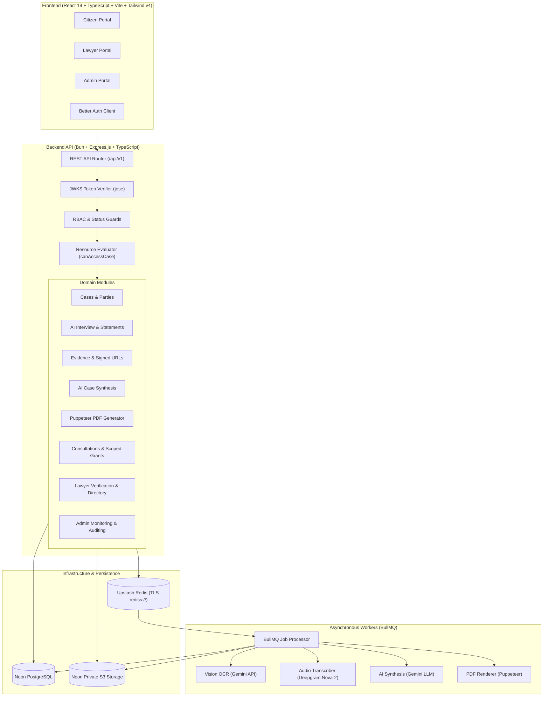

# NyayaPacket AI

> **Your Story. Organized. Your Legal Journey, Simplified.**

NyayaPacket AI is a production-grade LegalTech and citizen legal aid platform engineered for the Indian legal ecosystem. It transforms unstructured personal narratives, receipts, WhatsApp screenshots, rental agreements, audio notes, and PDFs into structured, source-linked, citizen-verified, and lawyer-ready legal case packets.

---

## 🏛️ System Architecture

NyayaPacket AI is built as a **Modular Monolith** with a dedicated background worker process:

---

## 📚 Project Documentation

Comprehensive documentation is maintained in the [`docs/`](docs/) directory:

| Document | Purpose |
| :--- | :--- |
| [**Project Understanding**](docs/PROJECT_UNDERSTANDING.md) | Vision, ethical boundaries, three application roles, case categories, and user journeys. |
| [**Implementation Decisions**](docs/IMPLEMENTATION_DECISIONS.md) | Technical decisions reconciling legacy specifications with current requirements (Better Auth, Gemini Vision, Deepgram, Upstash Redis, Neon S3). |
| [**Security Design**](docs/SECURITY_DESIGN.md) | Zero-trust threat model, JWKS verification, PostgreSQL-authoritative RBAC, resource authorization (`canAccessCase`), S3 presigned URL lifecycle, and admin privacy guards. |
| [**Testing Strategy**](docs/TESTING_STRATEGY.md) | Test pyramid, SEC-01 through SEC-13 release-blocking security test matrix, unit/integration setups, and CI gates. |
| [**Feature Checklist**](docs/FEATURE_CHECKLIST.md) | Granular implementation tracking across all 18 development phases. |
| [**Implementation Plan**](docs/IMPLEMENTATION_PLAN.md) | Detailed phase-by-phase execution roadmap from Phase 0 to Phase 17. |

---

## 🛠️ Technology Stack

- **Runtime & Toolchain**: [Bun](https://bun.sh/) (v1.2+)
- **Backend**: Express.js, TypeScript (Strict Mode), Prisma ORM
- **Database**: PostgreSQL (Neon PostgreSQL)
- **Authentication**: Better Auth / Neon Auth (`AUTH_URL`, `JWKS_URL`) with PostgreSQL RBAC
- **Queues & Cache**: Upstash Redis (TLS `rediss://`), BullMQ
- **Object Storage**: Neon Private S3 Storage (AWS SDK v3 `@aws-sdk/client-s3`)
- **AI & Vision**: Google Gemini Multimodal Vision API (with OpenAI fallback)
- **Audio Transcription**: Deepgram Nova-2 Speech-to-Text API
- **Document Generation**: Puppeteer (Headless Chromium)
- **Frontend**: React 19, TypeScript, Vite, Tailwind CSS (v4), shadcn/ui, Lucide React, TanStack Query v5, React Hook Form, Zod

---

## 🚦 Implementation Status

- [x] **Phase 0: Documentation & Project Discovery** (Completed)
- [x] **Phase 1: Repository & Backend Foundation** (Completed)
- [x] **Phase 2: Database & Better Auth Authentication** (Completed)
- [x] **Phase 3: Authorization & Security Foundation** (Completed)
- [ ] **Phase 4: Core Case Management** (In Progress)
- [ ] **Phase 5: AI Interview & Statements**
- [ ] **Phase 6: Evidence Management & Document Processing**
- [ ] **Phase 7: AI Case Analysis & Verification**
- [ ] **Phase 8: PDF Case Packet Generation**
- [ ] **Phase 9: Lawyer Verification & Public Directory**
- [ ] **Phase 10: Consultations & Case Sharing**
- [ ] **Phase 11: Lawyer Collaboration Workspace**
- [ ] **Phase 12: Notifications & Admin Backend**
- [ ] **Phase 13: Frontend Foundation & Public Website**
- [ ] **Phase 14: Citizen Portal Frontend**
- [ ] **Phase 15: Lawyer Portal Frontend**
- [ ] **Phase 16: Admin Portal Frontend**
- [ ] **Phase 17: End-to-End Integration, Validation & Release**

---

## 🔒 Security Principles

1. **PostgreSQL as Single Source of Truth**: Better Auth verifies identity; PostgreSQL strictly governs roles, account statuses, and lawyer verification.
2. **Zero Insecure Direct Object References (IDOR)**: Centralized resource authorization (`canAccessCase`) checks case ownership and active, non-revoked `AccessGrant` records on every request.
3. **Private Evidence Storage**: No public S3 buckets. Presigned upload and download URLs enforce 15-minute TTLs and cryptographic SHA-256 integrity checks.
4. **Admin Privacy Safeguards**: Platform administrators are restricted to case metadata by default; direct access to citizen evidence is blocked.
