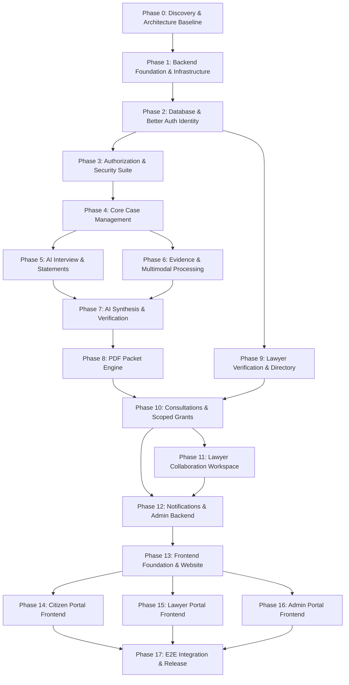

# NyayaPacket AI — Comprehensive Master Implementation Plan

## 1. Plan Structure & Execution Protocol

This implementation plan details the sequential progression of **NyayaPacket AI** across all 18 phases (Phase 0 through Phase 17).

To ensure production-grade security, code quality, and maintainability, the project operates under a strict **Milestone Gate Protocol**:
1. **Understand**: Review requirements, schemas, and security implications.
2. **Plan**: Formulate targeted implementation steps, touched files, and test specs.
3. **Implement**: Write modular, typed, production code. No mock shortcuts or fake stubs.
4. **Test**: Execute TypeScript checks, unit tests, integration tests, and security tests.
5. **Review**: Audit against authorization boundaries, data isolation, and performance.
6. **Document**: Update `docs/FEATURE_CHECKLIST.md` and `docs/IMPLEMENTATION_DECISIONS.md`.
7. **Report & Gate**: Deliver standard Milestone Report; advance only when all criteria pass.

---

## 2. Phase-by-Phase Implementation Roadmap

---

### PHASE 0 — Documentation & Project Discovery *(Current Phase)*
* **Scope**: Complete deep-dive into all 5 source specifications (`db.md`, `api.md`, `ui.md`, `system_architecture.md`, `nyayapacket.md`), repository state inspection, reconciliation of inconsistencies (Better Auth, Gemini Vision, Deepgram, S3, Upstash Redis), and baseline documentation creation.
* **Deliverables**:
  - `docs/PROJECT_UNDERSTANDING.md`
  - `docs/IMPLEMENTATION_DECISIONS.md`
  - `docs/SECURITY_DESIGN.md`
  - `docs/TESTING_STRATEGY.md`
  - `docs/FEATURE_CHECKLIST.md`
  - `docs/IMPLEMENTATION_PLAN.md`
* **Acceptance Criteria**: All 6 architectural documents created, cross-dependencies mapped, discrepancies reconciled, clean workspace confirmed.

---

### PHASE 1 — Repository & Backend Foundation
* **Scope**: Modular Bun + Express backend foundation with centralized logging, security headers, request IDs, rate-limiting, error handling envelope, and verified database/Redis connectivity.
* **Key Files**:
  - `server/src/config/env.ts`: Zod environment schema (`DATABASE_URL`, `REDIS_URL`, `AUTH_URL`, `JWKS_URL`, etc.).
  - `server/src/utils/logger.ts`: Structured Pino/Winston logger with PII masking.
  - `server/src/middleware/errorHandler.ts`: Standardized error envelope (`{ success: false, message, error: { code, details } }`).
  - `server/src/middleware/requestId.ts`: UUID request tracking.
  - `server/src/lib/prisma.ts`: Instantiated Prisma Client with connection pool settings.
  - `server/src/lib/redis.ts`: Upstash Redis TLS client (`rediss://`).
  - `server/src/app.ts` & `server/src/index.ts`: Express application configuration and graceful shutdown.
  - `server/src/routes/health.ts`: `/health` and `/ready` endpoints.
* **Testing**:
  - Server boot test.
  - Health & readiness endpoint HTTP checks via Supertest.
  - Environment validation error tests on missing keys.
* **Acceptance Criteria**: Backend starts cleanly under Bun, connects to Neon PostgreSQL and Upstash Redis, health endpoints return 200, TypeScript compilation succeeds with 0 errors.

---

### PHASE 2 — Database & Better Auth (Neon Auth) Authentication
* **Scope**: Prisma schema migration, Neon Auth JWKS token verification via `jose`, synchronous user provisioning, and user profile management.
* **Key Files**:
  - `server/prisma/schema.prisma`: Comprehensive 24-model schema with `authUserId` unique constraint.
  - `server/prisma/seed.ts`: Seed script for dispute categories and practice areas.
  - `server/src/services/auth/tokenVerifier.ts`: JWKS verification against `JWKS_URL`.
  - `server/src/services/auth/userProvisioner.ts`: Idempotent user synchronization.
  - `server/src/middleware/authenticate.ts`: Bearer token extractor, JWKS verifier, and `req.user` binder.
  - `server/src/routes/auth.ts`: `GET /api/v1/auth/me`.
  - `server/src/routes/users.ts`: `GET /api/v1/users/me`, `PATCH /api/v1/users/me`.
  - `server/scripts/seedAdmin.ts`: Secure internal Admin provisioning CLI command.
* **Testing**:
  - Unit tests for token verification (valid, expired, tampered).
  - Integration tests for idempotent user creation and profile retrieval.
  - Account status check tests (`ACTIVE` vs. `SUSPENDED`).
* **Acceptance Criteria**: Valid Neon Auth JWT correctly resolves PostgreSQL user, unauthenticated requests are rejected (401), suspended users blocked (403), duplicate signups safely handled, admin bootstrap works.

---

### PHASE 3 — Authorization & Security Foundation
* **Scope**: Centralized role-based access control (RBAC), resource-level authorization (`canAccessCase`), granular permission scopes, and audit logging.
* **Key Files**:
  - `server/src/middleware/rbac.ts`: `allowRoles('CITIZEN', 'LAWYER', 'ADMIN')`, `requireActiveUser`, `requireApprovedLawyer`, `requireAdmin`.
  - `server/src/services/authz/canAccessCase.ts`: Central resource authorization engine.
  - `server/src/services/audit/auditLogger.ts`: Immutable audit logger writing to `AuditLog`.
  - `server/src/__tests__/security.test.ts`: Release-blocking security test suite.
* **Testing**:
  - SEC-01 through SEC-13 test suite: Cross-citizen IDOR, unapproved lawyer access, expired grant access, revoked grant access, admin evidence access block.
* **Acceptance Criteria**: All 13 security test cases pass without exception. Unauthorized access attempts return appropriate 403 Forbidden responses.

---

### PHASE 4 — Core Case Management
* **Scope**: Case lifecycle management, category listing, case creation with auto-generated case numbers, party management, and status history tracking.
* **Key Files**:
  - `server/src/routes/categories.ts`: `GET /api/v1/categories`.
  - `server/src/routes/cases.ts`: `POST /api/v1/cases`, `GET /api/v1/cases`, `GET /api/v1/cases/:id`, `PATCH /api/v1/cases/:id`.
  - `server/src/routes/parties.ts`: Party CRUD endpoints (`/api/v1/cases/:id/parties`).
  - `server/src/services/case/caseService.ts`: Case business logic and case number generation (`NP-YYYY-XXXX`).
  - `server/src/services/case/statusHistory.ts`: Automatic recording of status changes.
* **Testing**:
  - Case creation and uniqueness of case numbers.
  - Citizen isolation: Citizen B cannot read or modify Citizen A's case.
  - Status transition validation and history logging.
* **Acceptance Criteria**: Citizens can create, inspect, and update their cases; cross-user case access is prevented; status transitions generate audit entries.

---

### PHASE 5 — AI Interview & Citizen Statements
* **Scope**: Guided interactive interview sessions, category-tailored prompts (unpaid wages, tenancy, consumer complaints), statement compilation, and save/resume workflows.
* **Key Files**:
  - `server/src/routes/interviews.ts`: `POST /api/v1/cases/:id/interviews`, `POST /api/v1/cases/:id/interviews/:sessionId/messages`.
  - `server/src/routes/statements.ts`: `POST`, `GET /api/v1/cases/:id/statements`.
  - `server/src/services/interview/interviewService.ts`: Dynamic question state machine.
  - `server/src/services/interview/prompts/`: Domain-specific legal intake question trees.
* **Testing**:
  - Session creation, message exchange, and session resumption.
  - Ownership validation on interview sessions.
  - Statement generation on interview completion.
* **Acceptance Criteria**: Citizen can complete an interview, messages are saved in chronological order, case statements are linked to the case owner.

---

### PHASE 6 — Evidence Management & Document Processing
* **Scope**: S3-compatible private object storage integration, presigned upload URLs, upload completion validation, SHA-256 hash checks, BullMQ worker queue for OCR (Gemini Vision) and audio transcription (Deepgram Nova-2).
* **Key Files**:
  - `server/src/services/storage/s3Client.ts`: Neon S3 adapter via AWS SDK v3.
  - `server/src/routes/evidence.ts`: Presigned upload and download endpoints.
  - `server/src/queues/evidenceQueue.ts`: BullMQ queue definition (`evidence-processing-queue`).
  - `server/src/worker.ts`: Dedicated BullMQ worker runner.
  - `server/src/workers/ocrWorker.ts`: Multimodal Gemini extraction worker.
  - `server/src/workers/audioWorker.ts`: Deepgram transcription worker.
* **Testing**:
  - Upload URL generation with file type/size enforcement.
  - SHA-256 integrity validation upon completion.
  - Worker processing execution with mocked AI responses.
  - Presigned download URL authorization gating.
* **Acceptance Criteria**: Files are uploaded directly to private S3, SHA-256 hashes verified, background worker extracts text and transcripts, unauthorized downloads blocked.

---

### PHASE 7 — AI Case Analysis & Verification
* **Scope**: AI provider abstraction, Gemini-powered structured case summarization, chronological timeline extraction, missing info detection, provenance validation (no hallucinated IDs), and citizen verification workflows.
* **Key Files**:
  - `server/src/services/ai/aiProvider.ts`: Provider interfaces (`ILLMProvider`).
  - `server/src/services/ai/geminiProvider.ts`: Gemini implementation with Zod schema parsing.
  - `server/src/services/ai/provenanceValidator.ts`: Cross-checks extracted fact source IDs against database `Evidence` and `Statement` records.
  - `server/src/routes/timeline.ts`: Timeline listing and citizen verification endpoints (`PATCH /api/v1/cases/:id/timeline/:eventId`).
  - `server/src/routes/ai.ts`: `POST /api/v1/cases/:id/ai/analyze`.
  - `server/src/workers/aiAnalysisWorker.ts`: BullMQ worker job for case analysis.
* **Testing**:
  - LLM response schema validation against Zod schemas.
  - Provenance test: Injection of non-existent source ID results in rejection/sanitization.
  - Citizen confirmation and correction updates verification status.
* **Acceptance Criteria**: AI outputs structured summaries and timelines, all facts link to existing case sources, citizen can correct and confirm claims.

---

### PHASE 8 — PDF Case Packet Generation
* **Scope**: HTML template compilation, server-side PDF generation via Puppeteer, SHA-256 packet hashing, packet versioning, and secure download management.
* **Key Files**:
  - `server/src/services/pdf/templates/packetTemplate.html`: Production LegalTech styled template.
  - `server/src/services/pdf/pdfGenerator.ts`: Puppeteer rendering engine.
  - `server/src/queues/pdfQueue.ts`: BullMQ `pdf-generation-queue`.
  - `server/src/workers/pdfWorker.ts`: PDF generation worker.
  - `server/src/routes/packets.ts`: `POST /api/v1/cases/:id/packets/generate`, `GET /api/v1/cases/:id/packets`, `GET /api/v1/cases/:id/packets/:version/download`.
* **Testing**:
  - PDF generation job execution and binary upload to S3.
  - Packet version incrementing (`version: 1, 2, ...`).
  - Tamper-evident checksum validation.
  - Download permission gating.
* **Acceptance Criteria**: Tamper-evident PDF generated with all sections (summary, parties, timeline, evidence index, disclaimer), stored privately in S3, downloadable only by authorized users.

---

### PHASE 9 — Lawyer Verification & Public Directory
* **Scope**: Lawyer onboarding profile submission, Bar Council certificate uploads, Admin review queue, approval/rejection decisions, and public directory search.
* **Key Files**:
  - `server/src/routes/lawyers.ts`: Profile management and public directory endpoints (`GET /api/v1/lawyers`, `GET /api/v1/lawyers/:id`).
  - `server/src/routes/adminLawyers.ts`: Admin review queue (`GET /api/v1/admin/lawyers/pending`, `PATCH /api/v1/admin/lawyers/:id/verification`).
  - `server/src/services/lawyer/lawyerService.ts`: Directory filtering and status management.
* **Testing**:
  - Lawyer registration defaults to `PENDING`.
  - Pending/rejected lawyers excluded from public directory.
  - Admin approval transitions lawyer to `APPROVED` and permits listing.
* **Acceptance Criteria**: Only approved, active lawyers appear in directory; verification audit trail is preserved.

---

### PHASE 10 — Consultations & Case Sharing
* **Scope**: Consultation request lifecycle (pending, accept, decline, reschedule), scoped case access grants (`AccessGrant`), granular permissions, and immediate revocation.
* **Key Files**:
  - `server/src/routes/consultations.ts`: Consultation request CRUD and response endpoints.
  - `server/src/routes/grants.ts`: `POST /api/v1/cases/:id/grants`, `DELETE /api/v1/cases/:id/grants/:grantId`, `GET /api/v1/cases/:id/grants`.
  - `server/src/services/consultation/consultationService.ts`: Consultation lifecycle.
  - `server/src/services/authz/grantManager.ts`: Grant issuance and revocation logic.
* **Testing**:
  - Consultation creation and state transitions.
  - Grant creation with specific scopes (`canViewSummary`, `canViewEvidence`, `canDownload`).
  - Revocation test: Once revoked, lawyer immediate access check returns 403.
* **Acceptance Criteria**: Citizens explicitly grant and revoke case access; lawyers see only authorized cases; revocation takes effect immediately.

---

### PHASE 11 — Lawyer Collaboration Workspace
* **Scope**: Lawyer shared case workspace, authorized evidence viewing, case comments with visibility flags (`SHARED_WITH_CITIZEN` vs. `PRIVATE_LAWYER_NOTE`), information requests, and action plans.
* **Key Files**:
  - `server/src/routes/lawyerWorkspace.ts`: `GET /api/v1/lawyers/me/shared-cases/:id`.
  - `server/src/routes/comments.ts`: `POST`, `GET /api/v1/cases/:id/comments`.
  - `server/src/routes/actionItems.ts`: Action plan CRUD (`/api/v1/cases/:id/action-items`).
  - `server/src/services/collaboration/collaborationService.ts`: Workspace logic.
* **Testing**:
  - Lawyer workspace access gated by active grant.
  - Note visibility: Citizen cannot view `PRIVATE_LAWYER_NOTE`.
  - Action item status tracking (`TODO` -> `COMPLETED`).
* **Acceptance Criteria**: Lawyers can collaborate only on authorized cases, private notes are protected, action items are tracked.

---

### PHASE 12 — Notifications & Admin Backend
* **Scope**: In-app notifications, notification preferences, admin metrics dashboard, user management (suspend/reactivate), case metadata monitoring, BullMQ job queue monitor, and audit log explorer.
* **Key Files**:
  - `server/src/routes/notifications.ts`: Notification retrieval and read-state management.
  - `server/src/routes/adminDashboard.ts`: Platform metrics (`/api/v1/admin/dashboard/metrics`).
  - `server/src/routes/adminUsers.ts`: User listing and status toggling (`/api/v1/admin/users`).
  - `server/src/routes/adminCases.ts`: Metadata-only case monitoring (`/api/v1/admin/cases`).
  - `server/src/routes/adminJobs.ts`: BullMQ queue health and metrics (`/api/v1/admin/jobs/status`).
  - `server/src/routes/adminAudit.ts`: System audit log inspection (`/api/v1/admin/audit-logs`).
* **Testing**:
  - Admin metadata visibility test (verifying case evidence is excluded).
  - User suspension stops API access immediately.
  - Audit log queries with filters.
* **Acceptance Criteria**: Admin functionality works securely without violating citizen privacy; notifications dispatch properly.

---

### PHASE 13 — Frontend Foundation & Public Website
* **Scope**: React 19 + TypeScript + Vite + Tailwind CSS (v4) + shadcn/ui setup, routing, Better Auth React client integration, theme provider (light/dark), public landing page, lawyer directory, and authentication screens.
* **Key Files**:
  - `client/src/App.tsx`, `client/src/main.tsx`: App root, router, TanStack Query provider.
  - `client/src/components/ui/`: shadcn/ui core components.
  - `client/src/lib/apiClient.ts`: Axios/fetch client with Bearer token injection.
  - `client/src/lib/auth.ts`: Better Auth client instance.
  - `client/src/pages/public/LandingPage.tsx`: High-impact landing page.
  - `client/src/pages/public/LawyerDirectoryPage.tsx`: Searchable lawyer directory.
  - `client/src/pages/auth/LoginPage.tsx` & `RegisterPage.tsx`.
* **Testing**:
  - Component rendering and theme switching.
  - Route navigation and token synchronization.
* **Acceptance Criteria**: Public site renders cleanly, responsive layout works, login/signup flows integrate with Better Auth.

---

### PHASE 14 — Citizen Portal Frontend
* **Scope**: Complete citizen user experience: dashboard, case creation wizard, AI chat interview with voice input, evidence library with file upload, interactive timeline, citizen verification editor, PDF packet generator, and lawyer consultation manager.
* **Key Files**:
  - `client/src/pages/citizen/Dashboard.tsx`
  - `client/src/pages/citizen/CreateCaseWizard.tsx`
  - `client/src/pages/citizen/InterviewSession.tsx`
  - `client/src/pages/citizen/EvidenceManager.tsx`
  - `client/src/pages/citizen/TimelineVerification.tsx`
  - `client/src/pages/citizen/PacketViewer.tsx`
  - `client/src/pages/citizen/ConsultationManager.tsx`
* **Testing**:
  - Case wizard completion.
  - Evidence upload lifecycle with progress indicator.
  - Inline timeline verification editing.
* **Acceptance Criteria**: Citizens can execute the entire journey without mocked data.

---

### PHASE 15 — Lawyer Portal Frontend
* **Scope**: Lawyer onboarding wizard, verification status tracker, consultation inbox, availability calendar, and shared case workspace (evidence viewer, comments, private notes, action plan checklist).
* **Key Files**:
  - `client/src/pages/lawyer/Onboarding.tsx`
  - `client/src/pages/lawyer/VerificationStatus.tsx`
  - `client/src/pages/lawyer/LawyerDashboard.tsx`
  - `client/src/pages/lawyer/ConsultationInbox.tsx`
  - `client/src/pages/lawyer/SharedCaseWorkspace.tsx`
* **Testing**:
  - Pending lawyer gate: verified UI blocks access to workspace.
  - Consultation accept/decline dialogs.
  - Action plan creation.
* **Acceptance Criteria**: Approved lawyers can manage consultations and collaborate on shared cases; unapproved lawyers are restricted.

---

### PHASE 16 — Admin Portal Frontend
* **Scope**: Admin dashboard, lawyer verification review modal with document inspection, user management table, metadata-only case explorer, BullMQ job queue monitor, and audit log viewer.
* **Key Files**:
  - `client/src/pages/admin/AdminDashboard.tsx`
  - `client/src/pages/admin/LawyerVerificationQueue.tsx`
  - `client/src/pages/admin/UserManagement.tsx`
  - `client/src/pages/admin/CaseMonitoring.tsx`
  - `client/src/pages/admin/QueueMonitoring.tsx`
  - `client/src/pages/admin/AuditLogViewer.tsx`
* **Testing**:
  - Lawyer approval/rejection action flows.
  - User suspension toggling.
  - Audit log filtering.
* **Acceptance Criteria**: Admin operations work smoothly and respect privacy restrictions.

---

### PHASE 17 — Integration, End-to-End Testing & Release
* **Scope**: End-to-end integration testing with Playwright, security penetration checks, Docker Compose configuration, GitHub Actions CI workflow, production readiness review, and release sign-off.
* **Key Files**:
  - `client/e2e/citizenFlow.spec.ts`: Full citizen-to-lawyer E2E scenario.
  - `docker-compose.yml`: Multi-container orchestration (backend, worker, frontend).
  - `.github/workflows/ci.yml`: Automated CI pipeline.
  - `docs/DEPLOYMENT_GUIDE.md`: Deployment, backup, and recovery documentation.
* **Testing**:
  - Full automated Playwright test suite.
  - Security suite regression run.
  - Docker container build and boot check.
* **Acceptance Criteria**: Complete 17-step end-to-end user workflow succeeds; all 20 Master Acceptance Criteria are satisfied; release is approved.
