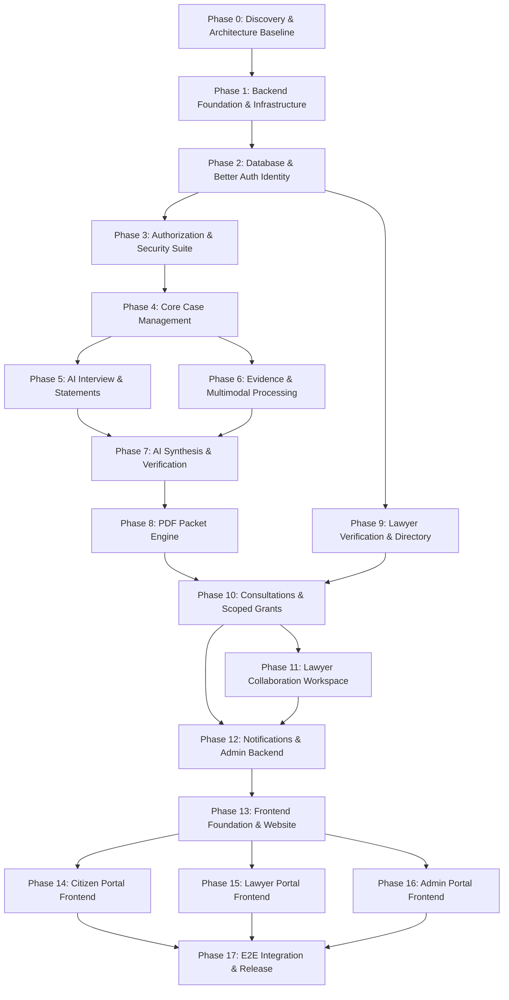

# NyayaPacket AI — Comprehensive Master Implementation Plan

## 1. Plan Structure & Execution Protocol

This implementation plan details the sequential progression of **NyayaPacket AI** across all 18 phases (Phase 0 through Phase 17).

To ensure production-grade security, code quality, and maintainability, the project operates under a strict **Milestone Gate Protocol**:
1. **Understand**: Review requirements, schemas, and security implications.
2. **Plan**: Formulate targeted implementation steps, touched files, and test specs.
3. **Implement**: Write modular, typed, production code. No mock shortcuts or fake stubs.
4. **Test**: Execute TypeScript checks, unit tests, integration tests, and security tests.
5. **Review**: Audit against authorization boundaries, data isolation, and performance.
6. **Document**: Update `docs/FEATURE_CHECKLIST.md` and `docs/IMPLEMENTATION_DECISIONS.md`.
7. **Report & Gate**: Deliver standard Milestone Report; advance only when all criteria pass.

---

## 2. Phase-by-Phase Implementation Roadmap

---

### PHASE 0 — Documentation & Project Discovery *(Current Phase)*
* **Scope**: Complete deep-dive into all 5 source specifications (`db.md`, `api.md`, `ui.md`, `system_architecture.md`, `nyayapacket.md`), repository state inspection, reconciliation of inconsistencies (Better Auth, Gemini Vision, Deepgram, S3, Upstash Redis), and baseline documentation creation.
* **Deliverables**:
  - `docs/PROJECT_UNDERSTANDING.md`
  - `docs/IMPLEMENTATION_DECISIONS.md`
  - `docs/SECURITY_DESIGN.md`
  - `docs/TESTING_STRATEGY.md`
  - `docs/FEATURE_CHECKLIST.md`
  - `docs/IMPLEMENTATION_PLAN.md`
* **Acceptance Criteria**: All 6 architectural documents created, cross-dependencies mapped, discrepancies reconciled, clean workspace confirmed.

---

### PHASE 1 — Repository & Backend Foundation
* **Scope**: Modular Bun + Express backend foundation with centralized logging, security headers, request IDs, rate-limiting, error handling envelope, and verified database/Redis connectivity.
* **Key Files**:
  - `server/src/config/env.ts`: Zod environment schema (`DATABASE_URL`, `REDIS_URL`, `AUTH_URL`, `JWKS_URL`, etc.).
  - `server/src/utils/logger.ts`: Structured Pino/Winston logger with PII masking.
  - `server/src/middleware/errorHandler.ts`: Standardized error envelope (`{ success: false, message, error: { code, details } }`).
  - `server/src/middleware/requestId.ts`: UUID request tracking.
  - `server/src/lib/prisma.ts`: Instantiated Prisma Client with connection pool settings.
  - `server/src/lib/redis.ts`: Upstash Redis TLS client (`rediss://`).
  - `server/src/app.ts` & `server/src/index.ts`: Express application configuration and graceful shutdown.
  - `server/src/routes/health.ts`: `/health` and `/ready` endpoints.
* **Testing**:
  - Server boot test.
  - Health & readiness endpoint HTTP checks via Supertest.
  - Environment validation error tests on missing keys.
* **Acceptance Criteria**: Backend starts cleanly under Bun, connects to Neon PostgreSQL and Upstash Redis, health endpoints return 200, TypeScript compilation succeeds with 0 errors.

---

### PHASE 2 — Database & Better Auth (Neon Auth) Authentication
* **Scope**: Prisma schema migration, Neon Auth JWKS token verification via `jose`, synchronous user provisioning, and user profile management.
* **Key Files**:
  - `server/prisma/schema.prisma`: Comprehensive 24-model schema with `authUserId` unique constraint.
  - `server/prisma/seed.ts`: Seed script for dispute categories and practice areas.
  - `server/src/services/auth/tokenVerifier.ts`: JWKS verification against `JWKS_URL`.
  - `server/src/services/auth/userProvisioner.ts`: Idempotent user synchronization.
  - `server/src/middleware/authenticate.ts`: Bearer token extractor, JWKS verifier, and `req.user` binder.
  - `server/src/routes/auth.ts`: `GET /api/v1/auth/me`.
  - `server/src/routes/users.ts`: `GET /api/v1/users/me`, `PATCH /api/v1/users/me`.
  - `server/scripts/seedAdmin.ts`: Secure internal Admin provisioning CLI command.
* **Testing**:
  - Unit tests for token verification (valid, expired, tampered).
  - Integration tests for idempotent user creation and profile retrieval.
  - Account status check tests (`ACTIVE` vs. `SUSPENDED`).
* **Acceptance Criteria**: Valid Neon Auth JWT correctly resolves PostgreSQL user, unauthenticated requests are rejected (401), suspended users blocked (403), duplicate signups safely handled, admin bootstrap works.

---

### PHASE 3 — Authorization & Security Foundation
* **Scope**: Centralized role-based access control (RBAC), resource-level authorization (`canAccessCase`), granular permission scopes, and audit logging.
* **Key Files**:
  - `server/src/middleware/rbac.ts`: `allowRoles('CITIZEN', 'LAWYER', 'ADMIN')`, `requireActiveUser`, `requireApprovedLawyer`, `requireAdmin`.
  - `server/src/services/authz/canAccessCase.ts`: Central resource authorization engine.
  - `server/src/services/audit/auditLogger.ts`: Immutable audit logger writing to `AuditLog`.
  - `server/src/__tests__/security.test.ts`: Release-blocking security test suite.
* **Testing**:
  - SEC-01 through SEC-13 test suite: Cross-citizen IDOR, unapproved lawyer access, expired grant access, revoked grant access, admin evidence access block.
* **Acceptance Criteria**: All 13 security test cases pass without exception. Unauthorized access attempts return appropriate 403 Forbidden responses.

---

### PHASE 4 — Core Case Management
* **Scope**: Case lifecycle management, category listing, case creation with auto-generated case numbers, party management, and status history tracking.
* **Key Files**:
  - `server/src/routes/categories.ts`: `GET /api/v1/categories`.
  - `server/src/routes/cases.ts`: `POST /api/v1/cases`, `GET /api/v1/cases`, `GET /api/v1/cases/:id`, `PATCH /api/v1/cases/:id`.
  - `server/src/routes/parties.ts`: Party CRUD endpoints (`/api/v1/cases/:id/parties`).
  - `server/src/services/case/caseService.ts`: Case business logic and case number generation (`NP-YYYY-XXXX`).
  - `server/src/services/case/statusHistory.ts`: Automatic recording of status changes.
* **Testing**:
  - Case creation and uniqueness of case numbers.
  - Citizen isolation: Citizen B cannot read or modify Citizen A's case.
  - Status transition validation and history logging.
* **Acceptance Criteria**: Citizens can create, inspect, and update their cases; cross-user case access is prevented; status transitions generate audit entries.

---

### PHASE 5 — AI Interview & Citizen Statements
* **Scope**: Guided interactive interview sessions, category-tailored prompts (unpaid wages, tenancy, consumer complaints), statement compilation, and save/resume workflows.
* **Key Files**:
  - `server/src/routes/interviews.ts`: `POST /api/v1/cases/:id/interviews`, `POST /api/v1/cases/:id/interviews/:sessionId/messages`.
  - `server/src/routes/statements.ts`: `POST`, `GET /api/v1/cases/:id/statements`.
  - `server/src/services/interview/interviewService.ts`: Dynamic question state machine.
  - `server/src/services/interview/prompts/`: Domain-specific legal intake question trees.
* **Testing**:
  - Session creation, message exchange, and session resumption.
  - Ownership validation on interview sessions.
  - Statement generation on interview completion.
* **Acceptance Criteria**: Citizen can complete an interview, messages are saved in chronological order, case statements are linked to the case owner.

---

### PHASE 6 — Evidence Management & Document Processing
* **Scope**: S3-compatible private object storage integration, presigned upload URLs, upload completion validation, SHA-256 hash checks, BullMQ worker queue for OCR (Gemini Vision) and audio transcription (Deepgram Nova-2).
* **Key Files**:
  - `server/src/services/storage/s3Client.ts`: Neon S3 adapter via AWS SDK v3.
  - `server/src/routes/evidence.ts`: Presigned upload and download endpoints.
  - `server/src/queues/evidenceQueue.ts`: BullMQ queue definition (`evidence-processing-queue`).
  - `server/src/worker.ts`: Dedicated BullMQ worker runner.
  - `server/src/workers/ocrWorker.ts`: Multimodal Gemini extraction worker.
  - `server/src/workers/audioWorker.ts`: Deepgram transcription worker.
* **Testing**:
  - Upload URL generation with file type/size enforcement.
  - SHA-256 integrity validation upon completion.
  - Worker processing execution with mocked AI responses.
  - Presigned download URL authorization gating.
* **Acceptance Criteria**: Files are uploaded directly to private S3, SHA-256 hashes verified, background worker extracts text and transcripts, unauthorized downloads blocked.

---

### PHASE 7 — AI Case Analysis & Verification
* **Scope**: AI provider abstraction, Gemini-powered structured case summarization, chronological timeline extraction, missing info detection, provenance validation (no hallucinated IDs), and citizen verification workflows.
* **Key Files**:
  - `server/src/services/ai/aiProvider.ts`: Provider interfaces (`ILLMProvider`).
  - `server/src/services/ai/geminiProvider.ts`: Gemini implementation with Zod schema parsing.
  - `server/src/services/ai/provenanceValidator.ts`: Cross-checks extracted fact source IDs against database `Evidence` and `Statement` records.
  - `server/src/routes/timeline.ts`: Timeline listing and citizen verification endpoints (`PATCH /api/v1/cases/:id/timeline/:eventId`).
  - `server/src/routes/ai.ts`: `POST /api/v1/cases/:id/ai/analyze`.
  - `server/src/workers/aiAnalysisWorker.ts`: BullMQ worker job for case analysis.
* **Testing**:
  - LLM response schema validation against Zod schemas.
  - Provenance test: Injection of non-existent source ID results in rejection/sanitization.
  - Citizen confirmation and correction updates verification status.
* **Acceptance Criteria**: AI outputs structured summaries and timelines, all facts link to existing case sources, citizen can correct and confirm claims.

---

### PHASE 8 — PDF Case Packet Generation
* **Scope**: HTML template compilation, server-side PDF generation via Puppeteer, SHA-256 packet hashing, packet versioning, and secure download management.
* **Key Files**:
  - `server/src/services/pdf/templates/packetTemplate.html`: Production LegalTech styled template.
  - `server/src/services/pdf/pdfGenerator.ts`: Puppeteer rendering engine.
  - `server/src/queues/pdfQueue.ts`: BullMQ `pdf-generation-queue`.
  - `server/src/workers/pdfWorker.ts`: PDF generation worker.
  - `server/src/routes/packets.ts`: `POST /api/v1/cases/:id/packets/generate`, `GET /api/v1/cases/:id/packets`, `GET /api/v1/cases/:id/packets/:version/download`.
* **Testing**:
  - PDF generation job execution and binary upload to S3.
  - Packet version incrementing (`version: 1, 2, ...`).
  - Tamper-evident checksum validation.
  - Download permission gating.
* **Acceptance Criteria**: Tamper-evident PDF generated with all sections (summary, parties, timeline, evidence index, disclaimer), stored privately in S3, downloadable only by authorized users.

---

### PHASE 9 — Lawyer Verification & Public Directory
* **Scope**: Lawyer onboarding profile submission, Bar Council certificate uploads, Admin review queue, approval/rejection decisions, and public directory search.
* **Key Files**:
  - `server/src/routes/lawyers.ts`: Profile management and public directory endpoints (`GET /api/v1/lawyers`, `GET /api/v1/lawyers/:id`).
  - `server/src/routes/adminLawyers.ts`: Admin review queue (`GET /api/v1/admin/lawyers/pending`, `PATCH /api/v1/admin/lawyers/:id/verification`).
  - `server/src/services/lawyer/lawyerService.ts`: Directory filtering and status management.
* **Testing**:
  - Lawyer registration defaults to `PENDING`.
  - Pending/rejected lawyers excluded from public directory.
  - Admin approval transitions lawyer to `APPROVED` and permits listing.
* **Acceptance Criteria**: Only approved, active lawyers appear in directory; verification audit trail is preserved.

---

### PHASE 10 — Consultations & Case Sharing
* **Scope**: Consultation request lifecycle (pending, accept, decline, reschedule), scoped case access grants (`AccessGrant`), granular permissions, and immediate revocation.
* **Key Files**:
  - `server/src/routes/consultations.ts`: Consultation request CRUD and response endpoints.
  - `server/src/routes/grants.ts`: `POST /api/v1/cases/:id/grants`, `DELETE /api/v1/cases/:id/grants/:grantId`, `GET /api/v1/cases/:id/grants`.
  - `server/src/services/consultation/consultationService.ts`: Consultation lifecycle.
  - `server/src/services/authz/grantManager.ts`: Grant issuance and revocation logic.
* **Testing**:
  - Consultation creation and state transitions.
  - Grant creation with specific scopes (`canViewSummary`, `canViewEvidence`, `canDownload`).
  - Revocation test: Once revoked, lawyer immediate access check returns 403.
* **Acceptance Criteria**: Citizens explicitly grant and revoke case access; lawyers see only authorized cases; revocation takes effect immediately.

---

### PHASE 11 — Lawyer Collaboration Workspace
* **Scope**: Lawyer shared case workspace, authorized evidence viewing, case comments with visibility flags (`SHARED_WITH_CITIZEN` vs. `PRIVATE_LAWYER_NOTE`), information requests, and action plans.
* **Key Files**:
  - `server/src/routes/lawyerWorkspace.ts`: `GET /api/v1/lawyers/me/shared-cases/:id`.
  - `server/src/routes/comments.ts`: `POST`, `GET /api/v1/cases/:id/comments`.
  - `server/src/routes/actionItems.ts`: Action plan CRUD (`/api/v1/cases/:id/action-items`).
  - `server/src/services/collaboration/collaborationService.ts`: Workspace logic.
* **Testing**:
  - Lawyer workspace access gated by active grant.
  - Note visibility: Citizen cannot view `PRIVATE_LAWYER_NOTE`.
  - Action item status tracking (`TODO` -> `COMPLETED`).
* **Acceptance Criteria**: Lawyers can collaborate only on authorized cases, private notes are protected, action items are tracked.

---

### PHASE 12 — Notifications & Admin Backend
* **Scope**: In-app notifications, notification preferences, admin metrics dashboard, user management (suspend/reactivate), case metadata monitoring, BullMQ job queue monitor, and audit log explorer.
* **Key Files**:
  - `server/src/routes/notifications.ts`: Notification retrieval and read-state management.
  - `server/src/routes/adminDashboard.ts`: Platform metrics (`/api/v1/admin/dashboard/metrics`).
  - `server/src/routes/adminUsers.ts`: User listing and status toggling (`/api/v1/admin/users`).
  - `server/src/routes/adminCases.ts`: Metadata-only case monitoring (`/api/v1/admin/cases`).
  - `server/src/routes/adminJobs.ts`: BullMQ queue health and metrics (`/api/v1/admin/jobs/status`).
  - `server/src/routes/adminAudit.ts`: System audit log inspection (`/api/v1/admin/audit-logs`).
* **Testing**:
  - Admin metadata visibility test (verifying case evidence is excluded).
  - User suspension stops API access immediately.
  - Audit log queries with filters.
* **Acceptance Criteria**: Admin functionality works securely without violating citizen privacy; notifications dispatch properly.

---

### PHASE 13 — Frontend Foundation & Public Website
* **Scope**: Production LegalTech design system, Vite + React 19 + TypeScript + Tailwind CSS (v4) setup, shadcn/ui components, Better Auth React integration, centralized API client, Theme Provider (Dark/Light), route architecture with RBAC boundaries, public landing page, lawyer directory, and authentication screens.
* **Sub-Milestones**:
  - **13.1 Toolchain & Design System Foundation**:
    - Install and configure dependencies: `lucide-react`, `react-router-dom`, `@tanstack/react-query`, `clsx`, `tailwind-merge`, `class-variance-authority`, `@better-auth/react`, `zod`, `react-hook-form`, `@hookform/resolvers/zod`.
    - Configure modern typography (Inter/Outfit via Google Fonts) and tailored LegalTech palette: Deep Court Navy (`#0f172a`, `#1e293b`), Gold/Saffron Accent (`#d97706`, `#f59e0b`), Legal Emerald (`#059669`), and Alert Crimson (`#dc2626`).
    - Build core shadcn/ui components in `client/src/components/ui/`: `Button`, `Card`, `Dialog`, `Input`, `Textarea`, `Select`, `Badge`, `Table`, `Tabs`, `Tooltip`, `Skeleton`, `Toast`.
    - Implement `ThemeProvider.tsx` supporting dark and light themes with system preference detection and `localStorage` persistence.
  - **13.2 Centralized API Client & Route Guards**:
    - Build `client/src/lib/apiClient.ts`: Axios/fetch client with automatic Bearer token injection, request ID forwarding, error normalization, and 401 redirect interceptors.
    - Build `client/src/lib/auth.ts`: Better Auth React client with auth state synchronization.
    - Implement Layout Boundaries:
      - `PublicLayout.tsx`: Header with navigation, theme toggle, authentication CTA, and legal disclaimer footer.
      - `CitizenLayout.tsx`: Citizen sidebar navigation (Dashboard, New Case, Consultations, Notifications).
      - `LawyerLayout.tsx`: Advocate sidebar (Workspace, Consultations, Calendar, Bar Verification).
      - `AdminLayout.tsx`: Admin management sidebar (KPIs, Lawyer Queue, Users, Cases, Queues, Audit).
      - `ProtectedRoute.tsx` & `RoleGate.tsx`: Role-based route protection blocking unauthorized access with custom `NotAllowedPage.tsx`.
  - **13.3 Public Pages & Authentication**:
    - `LandingPage.tsx`: High-conversion hero section, interactive 4-step workflow explainer ("Narrate Your Story" → "Upload Evidence" → "AI Analysis & Verification" → "Lawyer-Ready Packet"), case categories showcase, and statutory legal aid disclaimer.
    - `LawyerDirectoryPage.tsx`: Public advocate directory with live search, filters for city, state, practice area, consultation mode (Online/In-Person), experience sorting, and lawyer profile modal.
    - `LoginPage.tsx` & `RegisterPage.tsx`: Auth forms with role switcher (Citizen vs. Advocate), validation, and quick demo-login presets.
* **Key Files**:
  - `client/src/App.tsx`, `client/src/main.tsx`
  - `client/src/components/ui/*`
  - `client/src/components/layout/PublicLayout.tsx`, `CitizenLayout.tsx`, `LawyerLayout.tsx`, `AdminLayout.tsx`
  - `client/src/components/auth/ProtectedRoute.tsx`, `RoleGate.tsx`
  - `client/src/lib/apiClient.ts`, `client/src/lib/auth.ts`
  - `client/src/pages/public/LandingPage.tsx`, `LawyerDirectoryPage.tsx`, `AboutPage.tsx`
  - `client/src/pages/auth/LoginPage.tsx`, `RegisterPage.tsx`, `UnauthorizedPage.tsx`, `NotFoundPage.tsx`
* **Testing**:
  - Component unit tests for UI elements and form validation.
  - Route navigation and authentication redirect tests.
  - Dark/light mode theme toggle rendering tests.
* **Acceptance Criteria**: Responsive modern UI renders without console errors; public directory filters lawyers correctly; authentication routes smoothly navigate to role dashboards.

---

### PHASE 14 — Citizen Portal Frontend
* **Scope**: Complete citizen workflow: dashboard with live case metrics, guided multi-step case creation wizard, dynamic AI intake interview with voice transcript integration, evidence dropzone with SHA-256 validation and presigned S3 upload, interactive chronology editor with source inspection, citizen verification certification, versioned PDF packet viewer, lawyer discovery, and scoped access grant manager with immediate revocation.
* **Sub-Milestones**:
  - **14.1 Citizen Dashboard & Case Management**:
    - `CitizenDashboard.tsx`: High-level metrics (active cases, pending actions, verified packets), case cards with status steppers (`NEW_CASE` → `READY_FOR_LAWYER`), quick intake CTA, and priority indicators.
    - `CaseDetailPage.tsx`: Overview tab, parties card, status timeline, and navigation tabs to Evidence, Timeline, Packet, and Consultations.
  - **14.2 Guided Multi-Step Case Creation Wizard**:
    - `CreateCaseWizard.tsx`:
      - Step 1: Category selection with visual icons (Consumer, Tenancy, Employment, Loan/Recovery, Family, Property, Cyber).
      - Step 2: Dispute details (title, incident date picker, city, state, narrative summary).
      - Step 3: Involved parties dynamic form (opposing party, employer/landlord, organization, contact info).
      - Step 4: Confirmation review and atomic case submission with automatic navigation to AI interview.
  - **14.3 Dynamic AI Intake Interview Interface**:
    - `InterviewChat.tsx`: Conversational interface displaying alternating citizen and AI messages, category-specific prompt flows, quick suggestion chips, voice recording button, and "Conclude & Compile Statement" action button.
  - **14.4 Evidence Dropzone & Document Library**:
    - `EvidenceManager.tsx`: Drag-and-drop file upload with client-side SHA-256 calculation, direct-to-S3 upload progress bar, MIME type whitelist validation, evidence cards with processing badges (`QUEUED`, `PROCESSING`, `COMPLETED`, `FAILED`), extracted OCR text preview drawer, and presigned download action.
  - **14.5 Interactive Chronological Timeline & Citizen Fact Verification**:
    - `TimelineVerification.tsx`: Chronological timeline of dispute events with dates, titles, descriptions, and clickable source reference badges (linking directly to evidence or statement citations).
    - Inline verification tools: Citizen can confirm events (`CITIZEN_CONFIRMED`), edit dates/descriptions (`CITIZEN_CORRECTED`), or mark disputed claims (`DISPUTED`).
    - Formal verification certification modal: Citizen signs off the verified snapshot (`CaseVerification`), stamping timestamp and verifier identity.
  - **14.6 PDF Case Packet Generation & Download**:
    - `PacketViewer.tsx`: "Generate Lawyer-Ready Packet" button triggering async BullMQ worker, live generation progress indicator, packet version selector (`v1`, `v2`, ...), tamper-evident SHA-256 checksum display with copy button, and secure download link.
  - **14.7 Lawyer Discovery, Consultations & Access Grants**:
    - `ConsultationManager.tsx`: Search verified advocates, book consultation dialog (date, time, mode: Online/In-Person, intake message), status tracking (Pending, Accepted with meeting link, Completed).
    - `AccessGrantManager.tsx`: Issue scoped case access to advocate with granular checkboxes (`canViewSummary`, `canViewEvidence`, `canDownload`, expiration days), active grants table, and **One-Click Immediate Revocation Button** with confirmation modal.
  - **14.8 Collaboration Workspace & Notifications**:
    - `CaseCollaboration.tsx`: Shared comments stream, advocate information request replies with attachment dropzone, and shared Action Plan checklist (`TODO` → `COMPLETED`).
    - `NotificationDrawer.tsx`: Slide-out panel for consultation alerts, packet ready notifications, and lawyer notes.
* **Key Files**:
  - `client/src/pages/citizen/CitizenDashboard.tsx`, `CaseDetailPage.tsx`
  - `client/src/pages/citizen/CreateCaseWizard.tsx`
  - `client/src/pages/citizen/InterviewChat.tsx`
  - `client/src/pages/citizen/EvidenceManager.tsx`
  - `client/src/pages/citizen/TimelineVerification.tsx`
  - `client/src/pages/citizen/PacketViewer.tsx`
  - `client/src/pages/citizen/ConsultationManager.tsx`
  - `client/src/pages/citizen/AccessGrantManager.tsx`
  - `client/src/pages/citizen/CaseCollaboration.tsx`
  - `client/src/components/notifications/NotificationDrawer.tsx`
* **Testing**:
  - Case wizard validation and form submission tests.
  - Evidence upload simulation with SHA-256 calculation.
  - Timeline inline status toggling and verification modal sign-off.
  - Grant creation and immediate revocation UI flow tests.
* **Acceptance Criteria**: Citizen can complete end-to-end case intake without mock fallbacks; private S3 URLs and SHA-256 hashes are displayed; grant revocation immediately reflects in the UI.

---

### PHASE 15 — Lawyer Portal Frontend
* **Scope**: Complete advocate experience: Bar Council onboarding and certificate upload wizard, verification status tracker with re-upload capability, advocate dashboard with pending consultations and active shared cases, consultation response dialogs, availability schedule calendar, and lawyer collaboration workspace with private notes and action plans.
* **Sub-Milestones**:
  - **15.1 Lawyer Onboarding & Credential Submission**:
    - `LawyerOnboarding.tsx`: Profile setup form (Bar Council Number, State Bar Council, Enrollment Year, Experience Years, City, State, Bio, Languages, Consultation modes, Practice Areas selection).
    - Certificate upload dropzone for Bar Council Enrollment Certificate and Bar ID card with instant S3 upload.
  - **15.2 Verification Status Gate**:
    - `VerificationStatus.tsx`: Real-time status display:
      - `PENDING`: Notice of review, pending document preview, and estimated verification timeframe.
      - `APPROVED`: Congratulatory banner, active directory status badge, and link to Advocate Dashboard.
      - `REJECTED`: Reason for rejection from administrator, and one-click certificate re-upload modal.
    - `PendingLawyerGate.tsx`: Wrapper preventing unverified advocates from accessing shared client cases.
  - **15.3 Advocate Dashboard & Availability Calendar**:
    - `LawyerDashboard.tsx`: High-level metrics (pending consultation requests, upcoming consultations, active shared cases, total case reviews).
    - `AvailabilityCalendar.tsx`: Weekly schedule editor for setting available consultation slots by day of week, start/end time, timezone (`Asia/Kolkata`), and online/in-person preference.
  - **15.4 Consultation Requests Inbox**:
    - `ConsultationInbox.tsx`: Consultation requests table with citizen name, dispute category, preferred time, message. Action dialogs:
      - Accept: Provide meeting link (Zoom/Google Meet), confirmed timestamp, and prep instructions.
      - Decline: Rejection reason note.
      - Reschedule: Propose alternative date and time.
  - **15.5 Lawyer Shared Case Collaboration Workspace**:
    - `SharedCaseWorkspace.tsx`: Multi-tab workspace enforcing scoped permissions:
      - Tab 1: AI Case Summary & Missing Information (gated by `canViewSummary`).
      - Tab 2: Verified Timeline & Claims Chronology with source reference inspection.
      - Tab 3: Authorized Evidence Viewer (gated by `canViewEvidence`; download button conditionally enabled based on `canDownload`).
      - Tab 4: Dual-Channel Comments: Tabbed editor allowing advocate to post either a `SHARED_WITH_CITIZEN` note or a confidential `PRIVATE_LAWYER_NOTE` (clearly highlighted with yellow/amber background and locked badge).
      - Tab 5: Action Plan & Task Manager: Create action items, set deadlines, assign to citizen or counsel, track status.
* **Key Files**:
  - `client/src/pages/lawyer/LawyerOnboarding.tsx`
  - `client/src/pages/lawyer/VerificationStatus.tsx`
  - `client/src/pages/lawyer/LawyerDashboard.tsx`
  - `client/src/pages/lawyer/AvailabilityCalendar.tsx`
  - `client/src/pages/lawyer/ConsultationInbox.tsx`
  - `client/src/pages/lawyer/SharedCaseWorkspace.tsx`
  - `client/src/components/lawyer/PrivateNoteEditor.tsx`
  - `client/src/components/lawyer/ActionPlanManager.tsx`
* **Testing**:
  - Onboarding form submission with Bar credential validation.
  - Verification gate blocking access for `PENDING` accounts.
  - Consultation accept/decline action flows.
  - Scoped permission enforcement (evidence download button disabled when `canDownload: false`).
* **Acceptance Criteria**: Approved lawyers can access only authorized cases; private notes are clearly styled and segregated; unapproved lawyers are restricted.

---

### PHASE 16 — Admin Portal Frontend
* **Scope**: Complete administrative governance interface: system KPIs dashboard, Bar Council verification review queue with document preview, user directory with suspension controls, case metadata monitor (strictly respecting Admin Privacy Guard), BullMQ background queue monitor, and security audit log explorer.
* **Sub-Milestones**:
  - **16.1 Admin Dashboard & System KPIs**:
    - `AdminDashboard.tsx`: Metrics cards (total users, active cases, completed packets, consultation requests, verified advocates), case distribution breakdown chart by category, system queue health overview.
  - **16.2 Lawyer Verification Review Queue**:
    - `LawyerVerificationQueue.tsx`: Pending advocates list, Bar credential details, embedded document inspection drawer (view certificate PDF/image via presigned admin URL), approval decision modal with notes, rejection decision modal with feedback reasons.
  - **16.3 User Directory & Suspension Management**:
    - `UserManagement.tsx`: Paginated table of all platform users, role filter (Citizen, Lawyer, Admin), status filter (Active, Suspended), search by name/email, account suspension dialog with audit reason input, account reactivation toggle.
  - **16.4 Case Metadata Explorer (Admin Privacy Guard)**:
    - `CaseMonitoring.tsx`: Platform-wide case activity monitor displaying case number, category, status, priority, owner name, packet count, creation timestamp. Strict privacy enforcement: UI contains no buttons or endpoints for opening citizen evidence files or private transcripts.
  - **16.5 BullMQ Background Queue Health Monitor**:
    - `QueueMonitoring.tsx`: Real-time queue metrics for `evidence-processing`, `ai-analysis-queue`, and `pdf-generation-queue` (Waiting, Active, Completed, Failed counts), refresh toggle, failed job inspect/retry trigger.
  - **16.6 Security Audit Log Explorer**:
    - `AuditLogViewer.tsx`: Searchable and filterable security audit trail showing timestamp, actor, action (`APPROVE_LAWYER`, `SUSPEND_USER`, `CASE_CREATED`, `ACCESS_REVOKED`), resource type, IP/metadata JSON viewer.
* **Key Files**:
  - `client/src/pages/admin/AdminDashboard.tsx`
  - `client/src/pages/admin/LawyerVerificationQueue.tsx`
  - `client/src/pages/admin/UserManagement.tsx`
  - `client/src/pages/admin/CaseMonitoring.tsx`
  - `client/src/pages/admin/QueueMonitoring.tsx`
  - `client/src/pages/admin/AuditLogViewer.tsx`
* **Testing**:
  - Admin approval flow updating lawyer status to `APPROVED` and triggering audit log.
  - User suspension flow blocking user immediately.
  - Privacy verification: Ensure admin case table contains zero links to evidence binaries.
* **Acceptance Criteria**: Admin operations function smoothly; lawyer verification review modal renders certificates; privacy restrictions are enforced in the UI.

---

### PHASE 17 — Integration, End-to-End Testing & Release
* **Scope**: Automated Playwright E2E integration test covering full citizen-to-lawyer journey, security penetration test, Docker Compose multi-service setup, GitHub Actions CI workflow, deployment documentation, and Master Acceptance Criteria sign-off.
* **Sub-Milestones**:
  - **17.1 Complete Automated Playwright E2E Journey**:
    - `client/e2e/fullJourney.spec.ts`: End-to-end automated browser scenario executing all 17 critical user steps:
      1. Citizen registers and logs in.
      2. Citizen creates a consumer dispute case with opposing party.
      3. Citizen completes AI intake interview.
      4. Citizen uploads PDF bill receipt evidence with SHA-256 check.
      5. Background worker extracts OCR text.
      6. Citizen triggers AI Case Analysis, generating structured summary and timeline.
      7. Citizen verifies timeline events, marks an event `CITIZEN_CONFIRMED`, and signs verification snapshot.
      8. Citizen compiles PDF Case Packet dossier and verifies SHA-256 hash.
      9. Lawyer registers and submits Bar Council certificate.
      10. Admin logs in, reviews certificate, and approves lawyer verification.
      11. Citizen browses public directory, finds verified lawyer, and requests consultation.
      12. Citizen issues scoped AccessGrant (`canViewSummary: true`, `canViewEvidence: true`, `canDownload: false`).
      13. Lawyer logs in, accepts consultation with meeting link.
      14. Lawyer opens Shared Case Workspace, views summary and evidence, but confirms download button is disabled.
      15. Lawyer posts `PRIVATE_LAWYER_NOTE` and creates Action Item for citizen.
      16. Citizen logs in, verifies private lawyer note is completely invisible, and completes action item.
      17. Citizen revokes AccessGrant; lawyer attempts to reload case and receives immediate 403 Forbidden.
  - **17.2 Security Penetration Suite**:
    - Automated tests verifying multi-tenant isolation, cross-citizen IDOR attempts, admin privacy guard boundaries, and rate limiting.
  - **17.3 Docker Compose Multi-Container Orchestration**:
    - `docker-compose.yml`: Local multi-service orchestration (server, worker, client, redis, postgres).
    - Healthcheck dependencies ensuring PostgreSQL and Redis are ready before API boot.
  - **17.4 CI/CD Pipeline & Production Readiness**:
    - `.github/workflows/ci.yml`: Automated GitHub Actions pipeline running lint, typecheck, bun test, and playwright E2E.
    - `docs/DEPLOYMENT_GUIDE.md`: Production deployment, environment variable reference, Neon DB/S3 configuration, backup and disaster recovery.
    - Verification against all 20 Master Acceptance Criteria with final release sign-off.
* **Key Files**:
  - `client/e2e/fullJourney.spec.ts`, `client/e2e/auth.spec.ts`, `client/e2e/security.spec.ts`
  - `docker-compose.yml`, `Dockerfile.server`, `Dockerfile.worker`, `Dockerfile.client`
  - `.github/workflows/ci.yml`
  - `docs/DEPLOYMENT_GUIDE.md`
  - `docs/ACCEPTANCE_SIGNOFF.md`
* **Testing**:
  - 100% passing Playwright E2E suite against live containers.
  - Full backend regression test suite (85+ tests).
* **Acceptance Criteria**: All 20 Master Acceptance Criteria are satisfied; multi-tenant isolation is confirmed; deployment documentation is complete.
