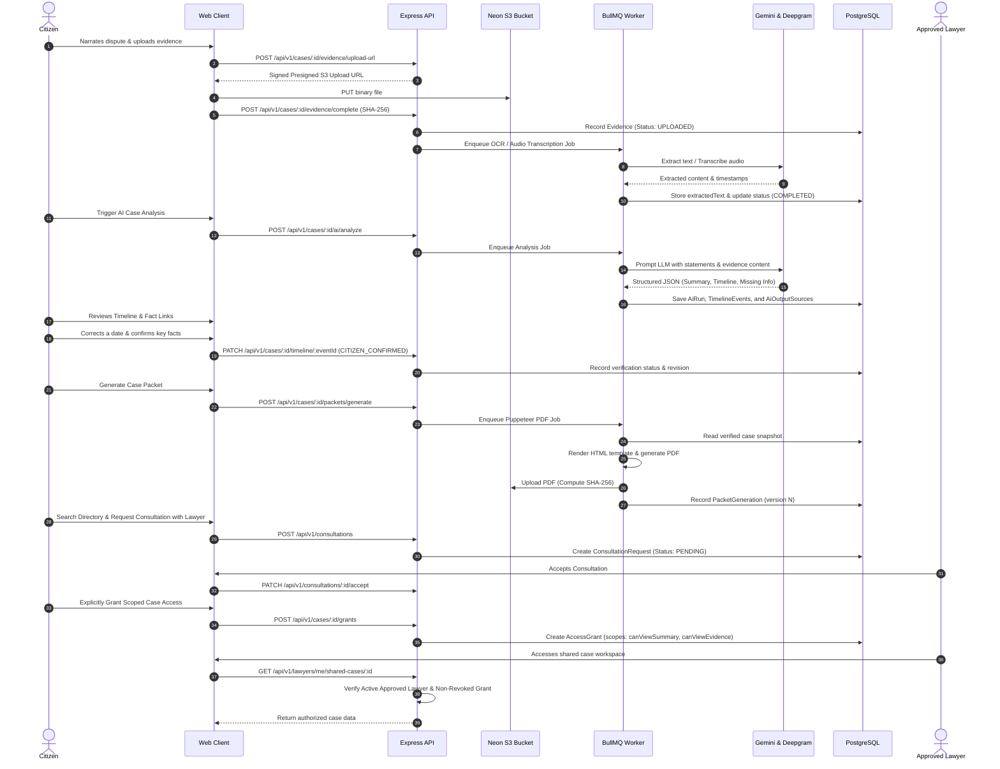

# NyayaPacket AI — Project Understanding & Architecture Baseline

## 1. Executive Summary & Vision

**Tagline:** *Your Story. Organized. Your Legal Journey, Simplified.*

**NyayaPacket AI** is a production-grade LegalTech and citizen legal aid platform engineered specifically for the Indian legal ecosystem. Its primary mission is to democratize and streamline access to justice by converting messy, fragmented, and emotionally overwhelming personal experiences into structured, source-referenced, citizen-verified, and lawyer-ready legal case packets.

In India, citizens confronting legal disputes—such as unpaid wages, tenant-landlord harassment, or consumer fraud—face steep hurdles before they can even obtain competent legal advice. Evidence is typically scattered across WhatsApp chats, UPI/bank payment receipts, voice notes, rental contracts, and emails. Litigants struggle to construct a coherent chronology or articulate legal facts without losing key details, while advocates spend excessive time on basic fact-finding and evidence sorting during initial consultations.

NyayaPacket AI bridges this gap through an empathetic, intelligent, and tamper-evident intake workflow:
```
Citizen Story / Voice / Media 
   ⬇
AI-Guided Categorized Intake & Evidence Ingestion
   ⬇
Multimodal Extraction (Gemini / Deepgram) & Provenance Graph
   ⬇
Chronological Case Synthesis & Source-Linked Fact Extraction
   ⬇
Human-in-the-Loop Verification & Citizen Correction
   ⬇
Tamper-Evident Versioned PDF Packet Generation (SHA-256)
   ⬇
Lawyer Directory Discovery & Scoped, Revocable Consultation
   ⬇
Lawyer Collaboration, Action Plans & Real-Time Tracking
```

---

## 2. Boundaries & Ethical Safeguards

NyayaPacket AI enforces strict boundaries regarding what it is and what it is **not**:

| What NyayaPacket AI IS | What NyayaPacket AI IS NOT |
| :--- | :--- |
| An AI-powered case preparation and document organization tool. | A generic legal chatbot giving unverified legal opinions. |
| An intake assistant structuring facts, chronologies, and evidence. | A substitute or replacement for an advocate enrolled with a Bar Council. |
| A tool providing neutral, source-linked summaries of citizen records. | A system determining liability, fault, guilt, or legal merit. |
| A platform linking claims directly to verified evidence uploads. | An automated system framing formal criminal/civil charges or petitions. |
| A secure collaboration hub with granular, revocable lawyer access. | An automated filing system that files complaints without human action. |
| A platform where AI outputs are flagged as assistance requiring human review. | An authority guaranteeing legal outcomes or court victories. |

All AI-generated summaries, chronologies, and identified inconsistencies include prominent disclaimers stating that the material is preliminary assistance and does not constitute formal legal advice.

---

## 3. Initial Supported Case Categories

The MVP focuses on three ubiquitous civil and quasi-civil dispute domains in India:

1. **Unpaid Wages / Employment Disputes**:
   - Focus: Salary withholdings, unpaid overtime, wrongful deductions, lack of relieving letters, breach of appointment contracts.
   - Evidence types: Offer letters, salary slips, bank statements, WhatsApp communications with HR/managers, attendance logs.
   - Statutory reference context: Payment of Wages Act, Industrial Disputes Act, Shops and Establishments Acts.

2. **Tenant-Landlord Disputes**:
   - Focus: Unlawful withholding of security deposits, arbitrary rent hikes, illegal eviction notices, maintenance disputes.
   - Evidence types: Registered/unregistered lease agreements, rent receipts, UPI transactions, photographic evidence of property condition, notices.
   - Statutory reference context: State Rent Control Acts, Model Tenancy Act, Transfer of Property Act.

3. **Consumer Complaints**:
   - Focus: Defective products, deficiency in services, misleading advertisements, refusal of refunds/warranties, e-commerce disputes.
   - Evidence types: Invoices, warranty cards, delivery receipts, customer support tickets, email threads, product photographs/videos.
   - Statutory reference context: Consumer Protection Act, 2019, Central Consumer Protection Authority (CCPA) guidelines.

---

## 4. Application Roles & Capabilities

The system defines exactly **three application roles**:

```mermaid
graph TD
    subgraph Roles
        Citizen["Role: CITIZEN<br/>(Self-Registration via Better Auth)"]
        Lawyer["Role: LAWYER<br/>(Registration + Bar Verification)"]
        Admin["Role: ADMIN<br/>(Controlled Internal Bootstrap Only)"]
    end

    subgraph Citizen Capabilities
        C1[Create & Manage Cases]
        C2[Complete AI-Guided Interviews]
        C3[Upload Multi-Format Evidence]
        C4[Review & Correct Synthesized Chronologies]
        C5[Generate Versioned PDF Packets]
        C6[Discover Verified Lawyers]
        C7[Grant / Revoke Scoped Case Access]
        C8[Track Action Plans & Deadlines]
    end

    subgraph Lawyer Capabilities
        L1[Submit Bar Council Credentials]
        L2[Track Verification Lifecycle: PENDING -> APPROVED]
        L3[Manage Practice Areas & Availability]
        L4[Receive Consultation Requests]
        L5[Access Explicitly Shared Case Workspaces]
        L6[Add Shared Comments & Private Notes]
        L7[Formulate Action Plans & Track Tasks]
    end

    subgraph Admin Capabilities
        A1[Review Lawyer Bar Credentials & Documents]
        A2[Approve / Reject / Suspend Lawyer Profiles]
        A3[Monitor User Accounts & Operational Metrics]
        A4[Oversee AI Queues, BullMQ Jobs & Errors]
        A5[Review System Audit Logs]
        A6[Zero Unrestricted Access to Citizen Evidence]
    end

    Citizen --> C1 & C2 & C3 & C4 & C5 & C6 & C7 & C8
    Lawyer --> L1 & L2 & L3 & L4 & L5 & L6 & L7
    Admin --> A1 & A2 & A3 & A4 & A5 & A6
```



### 4.1 Citizen
- **Registration**: Public registration via Better Auth (Email/Password).
- **Core Workflow**:
  - Initiates cases with descriptive titles, incidents, and categories.
  - Interacts with an AI interview agent via text or voice.
  - Uploads evidence (PDFs, screenshots, phone recordings, receipts) directly into private S3 storage.
  - Reviews AI-extracted facts, source links, and timeline events; explicitly confirms, modifies, or disputes each item.
  - Generates versioned, SHA-256 stamped PDF case packets.
  - Searches verified lawyers by location, practice area, language, and consultation mode (Online/In-person).
  - Explicitly grants scoped, time-bound access to an approved lawyer; can revoke access at any time with immediate effect.

### 4.2 Lawyer
- **Registration**: Public registration, but automatically placed in `PENDING` verification status.
- **Verification Gate**:
  - Must provide Bar Council enrollment number, State Bar Council, enrollment year, experience, city/state, practice areas, bio, and upload official enrollment certificates.
  - Cannot appear in the public directory, cannot receive consultation requests, and cannot access shared cases until an Admin approves their credentials (`APPROVED`).
- **Consultation & Workspace**:
  - Receives consultation requests; can accept, decline, or request a reschedule.
  - Once granted access by a citizen, accesses the shared case workspace strictly limited to granted permission scopes (`canViewSummary`, `canViewEvidence`, `canDownload`).
  - Writes citizen-visible comments and private professional notes.
  - Issues actionable items, tasks, and deadlines for the citizen.

### 4.3 Admin / Platform Team
- **Provisioning**: Absolutely no public admin registration. Provisioned via secure internal seed script or controlled environment bootstrap.
- **Responsibilities**:
  - Reviews pending lawyer applications, inspects uploaded certificates, and approves, rejects, or suspends profiles.
  - Manages taxonomy (Case Categories, Practice Areas).
  - Monitors BullMQ queue throughput, error rates, and AI performance.
  - Inspects system audit trails.
- **Privacy Constraint**: Admins do not have automatic or default read access to citizen evidence files or confidential case content. Exceptional administrative access requires logged, time-limited, role-audited actions.

---

## 5. End-to-End User Journeys

### 5.1 The Citizen Preparation & Sharing Journey


---

## 6. Architecture & Subsystem Relationships

The platform is structured as a **modular monolith** with clear architectural boundaries:

```mermaid
graph TB
    subgraph Client Application [Frontend - Vite + React 19 + TypeScript + Tailwind CSS]
        PublicApp["Public Website & Lawyer Directory"]
        CitizenPortal["Citizen Portal & Case Wizard"]
        LawyerPortal["Lawyer Portal & Workspace"]
        AdminPortal["Admin Management & Audit Portal"]
        AuthClient["Better Auth Client & JWT Manager"]
    end

    subgraph API Layer [Backend - Bun + Express.js + TypeScript]
        AuthMiddleware["Neon Auth JWKS Token Verifier & Context Builder"]
        RBACMiddleware["Role & Status Guard (requireActiveUser, allowRoles)"]
        ResourceAuthz["Centralized Resource Access Evaluator (canAccessCase)"]
        
        subgraph Modular Services
            CaseService["Case & Party Service"]
            InterviewService["Interview & Statement Service"]
            EvidenceService["Evidence & S3 Signed URL Service"]
            AIService["AI Orchestrator & Provider Abstraction"]
            PacketService["Packet Generation Service"]
            ConsultationService["Consultation & Grant Service"]
            LawyerService["Lawyer Profile & Directory Service"]
            AdminService["Admin Verification & Metric Service"]
            AuditService["Security Audit Logger"]
        end
    end

    subgraph Asynchronous Workers [BullMQ Worker Process]
        QueueManager["BullMQ Queues (Upstash Redis TLS)"]
        EvidenceJob["Evidence Processing Worker (Vision OCR / Deepgram)"]
        AIAnalysisJob["AI Synthesis Worker (Gemini LLM)"]
        PDFJob["PDF Packet Worker (Puppeteer Engine)"]
        NotificationJob["Notification & Alert Worker"]
    end

    subgraph External Infrastructure
        PostgresDB[("Neon PostgreSQL Database")]
        RedisQueue[("Upstash Redis (rediss://)")]
        PrivateS3[("Neon Object Storage (Private Bucket)")]
        GeminiAPI["Google Gemini 1.5/2.0 API"]
        DeepgramAPI["Deepgram Nova-2 Audio API"]
        NeonAuth["Neon Auth / Better Auth Server"]
    end

    ClientApplication --> API Layer
    AuthClient --> NeonAuth
    API Layer --> PostgresDB
    API Layer --> RedisQueue
    API Layer --> PrivateS3
    QueueManager --> EvidenceJob & AIAnalysisJob & PDFJob & NotificationJob
    EvidenceJob --> PrivateS3 & GeminiAPI & DeepgramAPI & PostgresDB
    AIAnalysisJob --> GeminiAPI & PostgresDB
    PDFJob --> PrivateS3 & PostgresDB
```

---

## 7. Key System Modules

1. **Identity & Provisioning (`auth`)**:
   - Manages user identity via Better Auth (Neon Auth) JWT and JWKS validation.
   - Synchronously provisions and links users into PostgreSQL during the first authenticated request with fallback webhooks.
   - Enforces PostgreSQL-authoritative roles (`CITIZEN`, `LAWYER`, `ADMIN`) and account statuses (`ACTIVE`, `SUSPENDED`, `DEACTIVATED`).

2. **Lawyer Lifecycle (`lawyer`)**:
   - Manages lawyer onboarding, Bar Council credentials, and certificate uploads.
   - Restricts lawyer directory discovery to `APPROVED` and `ACTIVE` profiles.
   - Enforces administrative review workflows for all credential updates.

3. **Case Management (`case`)**:
   - Supports case creation, party management, status lifecycle progression, and chronological audit histories.
   - Guarantees strict multi-tenant isolation so citizens can never access other citizens' cases.

4. **Evidence & Storage (`evidence`)**:
   - Private bucket storage with pre-signed short-lived upload/download URLs.
   - Computes SHA-256 file hashes client-side and validates them server-side upon completion.
   - Enforces MIME validation and file size restrictions.

5. **AI Extraction & Audio Transcription (`ai`)**:
   - Provider abstraction supporting Gemini Multimodal Vision and Deepgram Speech-to-Text.
   - Employs strict Zod schema validation on structured LLM responses.
   - Enforces provenance tracking: every synthesized timeline event and entity fact must map to existing database `evidenceId` or `statementId`. Hallucinated IDs are strictly rejected.

6. **Citizen Verification (`verification`)**:
   - Gives citizens complete ownership of generated facts.
   - Supports status flags: `UNVERIFIED`, `CITIZEN_CONFIRMED`, `CITIZEN_CORRECTED`, `LAWYER_REVIEWED`, and `DISPUTED`.
   - Preserves historical revisions when citizens modify AI-generated claims.

7. **PDF Packet Engine (`packet`)**:
   - Compiles case summaries, verified chronologies, evidence indexes, and legal questions into tamper-evident PDF documents via Puppeteer.
   - Stamped with case numbers, generation timestamps, and SHA-256 document checksums.

8. **Consultation & Granular Sharing (`consultation` & `grants`)**:
   - Consultation lifecycle: `PENDING` -> `ACCEPTED` / `DECLINED` / `RESCHEDULE_REQUESTED` -> `COMPLETED`.
   - Granular access grants with explicit permissions: `canViewSummary`, `canViewEvidence`, `canDownload`.
   - Immediate revocation and expiration enforcement across all data access endpoints.

9. **Lawyer Collaboration (`collaboration`)**:
   - Scoped workspace where authorized lawyers view evidence, write comments, create structured action plans, and assign actionable tasks with due dates.
   - Strict distinction between citizen-visible communications and private lawyer notes.

10. **Platform Administration & Security Auditing (`admin` & `audit`)**:
    - Centralized audit logging for every security-sensitive action.
    - Administrative approval queue for lawyer credentials.
    - Privacy protection: Admins monitor operational health and case metadata without reading citizen legal documents.
