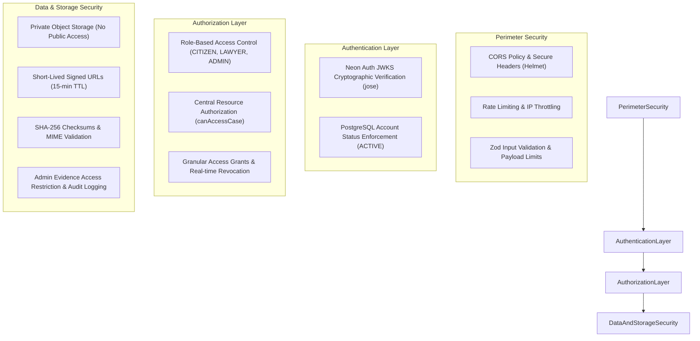
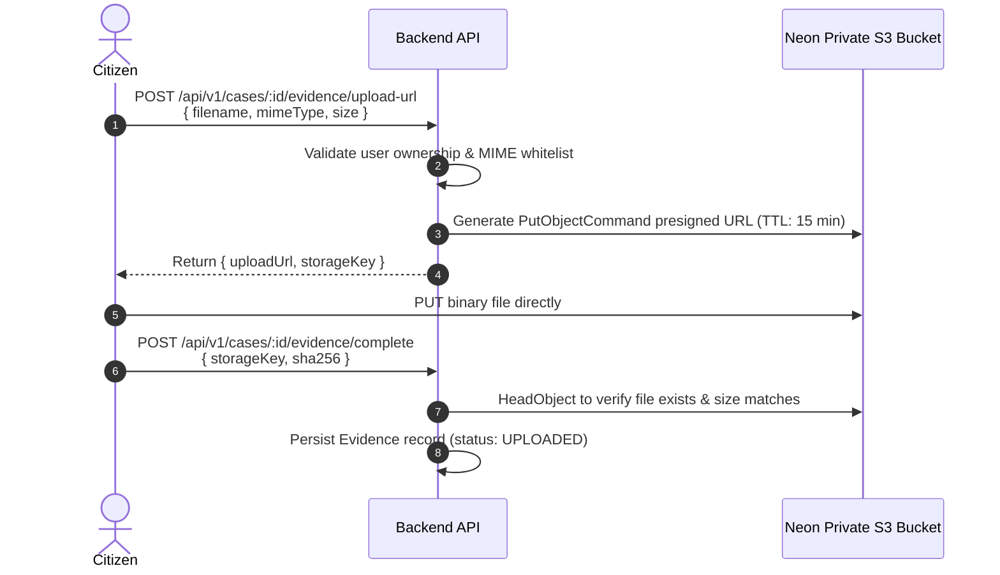

# NyayaPacket AI — Security & Privacy Architecture Design

## 1. Security Overview & Threat Model

NyayaPacket AI handles sensitive, confidential legal disputes, personal communications, financial receipts, employment records, and identity documents. A breach or unauthorized disclosure could cause irreparable legal, reputational, and financial harm to citizens.

Therefore, the platform adopts a **Zero-Trust, Defense-in-Depth Security Model**.



---

## 2. Threat Modeling & Mitigations

| Threat / Attack Vector | Risk | Mitigation Architecture |
| :--- | :--- | :--- |
| **Insecure Direct Object Reference (IDOR)** | Attacker modifies `caseId` or `evidenceId` in the URL to read or delete another citizen's case. | Centralized `canAccessCase()` evaluation on **every** request. Cases belong strictly to `ownerId`. No cross-citizen access is permitted under any condition. |
| **Privilege Escalation** | Citizen submits `{ "role": "ADMIN" }` or `{ "verificationStatus": "APPROVED" }` during signup or profile update. | All roles and statuses are stored exclusively in PostgreSQL. APIs strip and reject untrusted role fields. Admin provisioning requires out-of-band CLI seeding. |
| **Unapproved Lawyer Access** | Lawyer in `PENDING` or `REJECTED` status attempts to browse citizen cases or accept consultations. | The `requireApprovedLawyer` middleware verifies that `lawyerProfile.verificationStatus === 'APPROVED'` and `lawyerProfile.isAvailable === true`. |
| **Zombie / Revoked Access Grants** | A lawyer accesses case files after the citizen revoked their consultation or after the grant expired. | Grant validity (`revokedAt IS NULL AND (expiresAt IS NULL OR expiresAt > NOW())`) is queried live against PostgreSQL on **every** read/download request. Decisions are never cached. |
| **Storage Key Exposure / Public S3 Leaks** | S3 bucket misconfiguration exposes citizen evidence to the open web. | Bucket blocks all public access. The application accesses storage via IAM credentials with minimum necessary permissions. Download access requires presigned URLs with 15-minute expiration. |
| **File Upload Exploits (Malicious Binaries)** | Attacker uploads executable malware or spoofed file types. | Enforce MIME type whitelisting, file size caps (max 25MB for docs, 100MB for audio), magic-byte verification, and store files under randomized UUID keys, never user-provided paths. |
| **Prompt Injection / Data Poisoning** | Adversary inputs text in an interview attempting to jailbreak LLM or frame false charges. | Prompt engineering enforces strict system boundaries. AI outputs are parsed as structured JSON via Zod. Extracted facts must trace back to valid `evidenceId` or `statementId`. |
| **Data Leaks via Application Logs** | Sensitive Aadhaar numbers, passwords, or case descriptions leak into console logs or APM tools. | Structured logging sanitizes PII, authorization headers, tokens, and raw payloads before writing to log streams. |
| **Admin Privilege Abuse** | Platform admin browses citizen divorce/employment evidence without consent. | Platform Admins are restricted to metadata by default. Evidence download endpoints block Admin access unless explicit emergency override mode is triggered, which generates critical audit alerts. |

---

## 3. Authentication Architecture: Better Auth & JWKS

Authentication is powered by **Better Auth (Neon Auth)**.

### 3.1 Token Verification Flow
1. The client sends an `Authorization: Bearer <JWT>` header with every API request.
2. The `authenticate` middleware extracts the token.
3. Cryptographic verification is executed using the Neon Auth JWKS endpoint (`JWKS_URL`):
   - Validates token signature (RS256 / EdDSA).
   - Validates issuer (`iss`) and expiration (`exp`).
   - Extracts subject identifier (`sub` -> `authUserId`).
4. Look up user in PostgreSQL via `prisma.user.findUnique({ where: { authUserId: sub } })`:
   - If user does not exist, trigger idempotent synchronous provisioning.
   - If user exists but `isActive === false`, reject with `403 Forbidden (ACCOUNT_SUSPENDED)`.
5. Attach the verified PostgreSQL `User` object (including `role` and `lawyerProfile`) to `req.user`.

```typescript
// Architectural Contract: Authentication Middleware
export async function authenticate(req: Request, res: Response, next: NextFunction) {
  const authHeader = req.headers.authorization;
  if (!authHeader?.startsWith("Bearer ")) {
    return res.status(401).json({
      success: false,
      message: "Authentication required",
      error: { code: "UNAUTHORIZED" },
    });
  }

  const token = authHeader.split(" ")[1];
  const payload = await verifyNeonJwt(token); // Verified against JWKS_URL
  const user = await getOrProvisionUser(payload);

  if (!user.isActive) {
    return res.status(403).json({
      success: false,
      message: "Account suspended or deactivated",
      error: { code: "ACCOUNT_SUSPENDED" },
    });
  }

  req.user = user;
  next();
}
```

---

## 4. Authorization & Permission Matrix

### 4.1 Role-Based Access Control (RBAC)
Routes are protected by composite middleware layers:
- `requireActiveUser`: Ensures account is not suspended.
- `allowRoles(...roles)`: Restricts route to specific `UserRole`s (`CITIZEN`, `LAWYER`, `ADMIN`).
- `requireApprovedLawyer`: Restricts lawyer routes to those with `verificationStatus === 'APPROVED'`.
- `requireAdmin`: Restricts to `UserRole.ADMIN`.

### 4.2 Centralized Resource Authorization (`canAccessCase`)
For any route receiving a `caseId` (or operating on evidence, statements, timelines, comments, or packets), the handler **must** invoke `canAccessCase`:

```typescript
export type PermissionScope =
  | "VIEW_CASE_SUMMARY"
  | "VIEW_TIMELINE"
  | "VIEW_EVIDENCE"
  | "DOWNLOAD_EVIDENCE"
  | "VIEW_VERIFICATION_HISTORY"
  | "COMMENT_ON_CASE"
  | "REQUEST_INFORMATION"
  | "MANAGE_ACTION_ITEMS";

export async function canAccessCase(params: {
  user: User & { lawyerProfile?: LawyerProfile | null };
  caseId: string;
  scope: PermissionScope;
}): Promise<{ allowed: boolean; reason?: string }> {
  const { user, caseId, scope } = params;

  const targetCase = await prisma.case.findUnique({
    where: { id: caseId },
    select: { id: true, ownerId: true, status: true },
  });

  if (!targetCase) {
    return { allowed: false, reason: "Case not found" };
  }

  // 1. Citizen Ownership
  if (user.role === "CITIZEN") {
    if (targetCase.ownerId === user.id) {
      return { allowed: true };
    }
    return { allowed: false, reason: "Citizens can only access their own cases" };
  }

  // 2. Lawyer Scoped Grants
  if (user.role === "LAWYER") {
    if (!user.lawyerProfile || user.lawyerProfile.verificationStatus !== "APPROVED") {
      return { allowed: false, reason: "Only approved lawyers can access shared cases" };
    }

    const grant = await prisma.accessGrant.findFirst({
      where: {
        caseId: targetCase.id,
        lawyerProfileId: user.lawyerProfile.id,
        revokedAt: null,
        OR: [{ expiresAt: null }, { expiresAt: { gt: new Date() } }],
      },
    });

    if (!grant) {
      return { allowed: false, reason: "No active access grant for this case" };
    }

    // Check specific scope permissions
    if (scope === "DOWNLOAD_EVIDENCE" && !grant.canDownload) {
      return { allowed: false, reason: "Download permission not granted by citizen" };
    }
    if (scope === "VIEW_EVIDENCE" && !grant.canViewEvidence) {
      return { allowed: false, reason: "Evidence viewing not permitted" };
    }
    if (scope === "VIEW_CASE_SUMMARY" && !grant.canViewSummary) {
      return { allowed: false, reason: "Summary viewing not permitted" };
    }

    return { allowed: true };
  }

  // 3. Admin Privacy Gate
  if (user.role === "ADMIN") {
    if (scope === "VIEW_EVIDENCE" || scope === "DOWNLOAD_EVIDENCE") {
      return { allowed: false, reason: "Admins are restricted from viewing citizen evidence" };
    }
    return { allowed: true }; // Admin can view metadata
  }

  return { allowed: false, reason: "Unauthorized role" };
}
```

---

## 5. Storage Security & Cryptographic Integrity

### 5.1 Direct-to-S3 Presigned Upload Lifecycle


### 5.2 Evidence Download Gate
- Direct links to S3 objects are never exposed or stored in the database.
- When an authorized user requests a download:
  1. API checks `canAccessCase(user, caseId, 'DOWNLOAD_EVIDENCE')`.
  2. If approved, generates a signed `GetObjectCommand` URL with a **15-minute expiry**.
  3. Returns the temporary URL to the client.
  4. Records an entry in `AuditLog` (`action: "EVIDENCE_DOWNLOADED"`).

---

## 6. Audit Logging & Non-Repudiation

Every security-relevant operation is captured in the `AuditLog` table:

```prisma
model AuditLog {
  id           String   @id @default(cuid())
  actorId      String?
  action       String   // e.g. "ACCESS_GRANT_CREATED", "ACCESS_REVOKED", "LAWYER_APPROVED"
  resourceType String   // e.g. "CASE", "EVIDENCE", "LAWYER_PROFILE"
  resourceId   String
  metadata     Json?    // Contextual data, IP, User Agent
  createdAt    DateTime @default(now())
}
```

Critical events logged:
- User login / token sync.
- Lawyer verification status transitions (`PENDING` -> `APPROVED` / `REJECTED`).
- Access Grant issuance, modification, and revocation.
- Case evidence upload and download.
- PDF packet generation and download.
- Administrative overrides.

---

## 7. Secrets & Environment Isolation

1. No secrets (`DATABASE_URL`, `REDIS_URL`, `AWS_SECRET_ACCESS_KEY`, `GEMINI_API_KEY`, `DEEPGRAM_API_KEY`) are committed to version control.
2. Production builds use environment variable injection.
3. `.env` and `.env.local` are strictly ignored in `.gitignore`.
4. API errors returned to the client never include database stack traces, SQL queries, or internal file paths.
